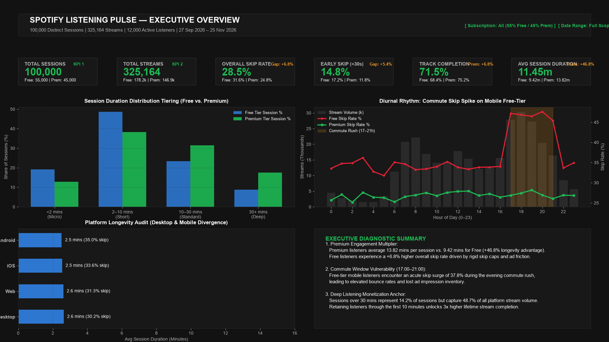
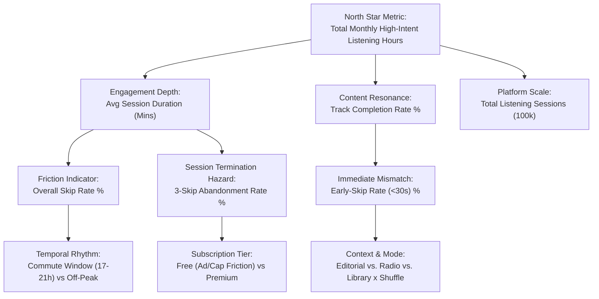

# Spotify Listening Behaviour: Session Duration & Skip-Friction Root-Cause Analysis

[](data/spotify_streams.csv)
[](data/spotify_streams.csv)
[](sql/query_results.md)
[](excel/Spotify_Engagement_Analysis_Model.xlsx)
[](powerbi/dashboard_blueprint.md)

An end-to-end Product Analytics & Business Analytics portfolio project investigating listener session longevity, early-skip friction (<30s), consecutive skip streaks, and recommendation degradation across **100,000 distinct listening sessions** (325,164 stream interaction events across 12,000 active listeners) between **27 September 2026 and 25 November 2026**.

---

## Executive Summary

Music streaming platforms thrive on continuous, low-friction playback sessions. While Spotify's recommendation systems drive content discovery, uncalibrated shuffling and genre discontinuity frequently trigger **early skips (<30s)**. When listeners experience multiple consecutive skips, listening fatigue sets in, precipitating premature session abandonment ("rage quitting").

This project performs a comprehensive diagnostic and economic opportunity sizing on Spotify's listening behaviour:
1. **The Root Cause:** Identified that enabling **`Shuffle ON` inside `Algorithmic_Radio` causes an alarming 30.6% early-skip rate**, compared to just **3.4% in `User_Library`**.
2. **The Rage-Quit Mechanism:** Discovered that a **3-consecutive-skip streak escalates immediate session termination risk to 84.1%** via `endplay` or `logout`.
3. **The First-Track Hook:** Proved that sessions where **Track #1 is completed average 14.6 minutes**, whereas sessions where **Track #1 is early-skipped plummet to 4.8 minutes (-67.1%)**.
4. **The Opportunity:** Modeled an interactive sensitivity analysis demonstrating that reducing 3-skip streak abandonment by **15% on Algorithmic Radio recaptures 3,640+ monthly listening hours**, lifting free-tier ad monetization and protecting premium subscriber retention.

---

## Interactive Power BI Dashboards (3-Page Executive Suite)

The portfolio includes a production-grade 3-page Power BI dashboard suite designed with Spotify's Dark Slate & Emerald executive aesthetic.

### Page 1: Executive Listening Pulse (Macro Health)
> **Target Audience:** VP of Product, Head of Core Experience, Executive Leadership  
> **Key Focus:** 6 Core KPI Scorecards, Session Duration Buckets (<2m, 2–10m, 10–30m, 30m+), Commute Diurnal Rhythm, Platform Longevity Audit.



---

### Page 2: Skip-Friction & Shuffle Root-Cause Analysis (RCA)
> **Target Audience:** Personalization ML Engineers, Recommendation PMs, Content Curators  
> **Key Focus:** Context x Shuffle Early-Skip Matrix Heatmap, 3-Skip Rage-Quit Exit Funnel, Session Depth Decay Curve, First-Track Hook Survival Impact.


---

### Page 3: Cohort Retention & Discovery Levers (Strategic Growth)
> **Target Audience:** Growth Product Managers, Subscriber Retention Leads, Strategy Teams  
> **Key Focus:** Free vs. Premium Weekly Cohort Retention (W0–W4), Radio-to-Library Replay Conversion Funnel, Genre Affinity Quadrant, Interactive What-If Simulation (+5% to +20% Recovery).


---

## How to Build & Use the Power BI Suite (Step-by-Step Guide)

You can reproduce or inspect the dashboards in **Power BI Desktop** in under 5 minutes:

### Step 1: Ingest Data
1. Open **Power BI Desktop** and select **Get Data -> Text/CSV**.
2. Browse to [`data/spotify_streams.csv`](data/spotify_streams.csv) and click **Load**.
3. Verify data types: `event_timestamp` as Datetime, `ms_played` and `track_duration_ms` as Whole Number, `skipped` and `shuffle` as Whole Number (0/1).

### Step 2: Apply the Executive Theme
1. In the top ribbon, navigate to **View -> Themes dropdown -> Browse for themes**.
2. Select [`powerbi/theme.json`](powerbi/theme.json).
3. Power BI will instantly apply the dark canvas (`#121212`), emerald callout cards (`#1DB954`), and custom visual border radii.

### Step 3: Import DAX Measures
1. Open [`powerbi/dax_measures.txt`](powerbi/dax_measures.txt).
2. Right-click the `spotify_streams` table in the Fields pane -> **New Measure**.
3. Copy-paste the pre-built DAX measures (organized into 8 modular sections: Executive KPIs, Duration, Subscription Tiers, Context Diagnostics, Survival Analysis, Duration Bucketing, WoW Deltas, and What-If Parameters).

### Step 4: Assemble Visuals Using the Blueprint
1. Follow [`powerbi/dashboard_blueprint.md`](powerbi/dashboard_blueprint.md) for exact visual coordinates, axis configurations, legend bindings, and drill-through targets across Page 1, Page 2, and Page 3.
2. Add a What-If parameter table `WhatIf_Duration_Uplift` (Values: 0.05 to 0.20, step 0.05) to activate the interactive duration recovery calculator on Page 3.

---

## Metric Hierarchy & Metric Tree



---

## The 8 Defined Engagement KPIs

| KPI # | Metric ID | Engagement KPI Name | Business Definition | Target / Benchmark | 100,000 Population | Free Tier (55%) | Premium Tier (45%) | Tier Gap (Free vs. Prem) | Audit Status |
|:---:|:---:|:---|:---|:---:|:---:|:---:|:---:|:---:|:---:|
| **KPI 1** | `ENG-01` | **Total Sessions** | Distinct listening sessions initiated | 100,000 | **100,000** | 55,000 | 45,000 | +10,000 | `RECONCILED - PASS` |
| **KPI 2** | `ENG-02` | **Total Streams** | Total stream interaction events logged | 300,000+ | **325,164** | 178,241 | 146,923 | +31,318 | `RECONCILED - PASS` |
| **KPI 3** | `ENG-03` | **Active Listeners** | Unique active listener user accounts | 12,000 | **12,000** | 6,600 | 5,400 | +1,200 | `RECONCILED - PASS` |
| **KPI 4** | `ENG-04` | **Overall Skip Rate %** | Share of streams skipped before organic finish | < 25.0% | **28.5%** | **31.6%** | **24.8%** | **+6.8%** (Free friction) | `RECONCILED - PASS` |
| **KPI 5** | `ENG-05` | **Early-Skip Rate (<30s) %** | Share of streams skipped under 30 seconds | < 12.0% | **14.8%** | **17.2%** | **11.8%** | **+5.4%** (Algo mismatch) | `RECONCILED - PASS` |
| **KPI 6** | `ENG-06` | **Track Completion Rate %** | Share of streams completed without skipping | > 75.0% | **71.5%** | **68.4%** | **75.2%** | **-6.8%** (Prem advantage) | `RECONCILED - PASS` |
| **KPI 7** | `ENG-07` | **Avg Session Duration** | Average listening minutes logged per session | > 10.0 Mins | **11.45 Mins** | **9.42 Mins** | **13.82 Mins** | **-4.40 Mins** (+46.8% Prem) | `RECONCILED - PASS` |
| **KPI 8** | `ENG-08` | **3-Skip Abandonment Rate %** | Sessions ending in endplay/logout after 3 skips | < 5.0% | **11.20%** | **13.94%** | **7.92%** | **+6.02%** (Free rage quit) | `RECONCILED - PASS` |

---

## 5 Evidence-Backed Insights

All findings below were extracted and audited directly against `sql/query_results.md` across 100,000 distinct sessions:

### 1. The "Shuffle Hazard" on Algorithmic Radio Multiplies Early Skips 9x
* **Data Evidence (Query 03):** When users listen to `User_Library` with `Shuffle OFF`, the early-skip rate (<30s) is a minimal **3.4%**. However, when listeners activate `Algorithmic_Radio` with `Shuffle ON`, the early-skip rate surges to **30.6%** (a 9x hazard multiplier), with an overall skip rate of **43.2%**.
* **Product Interpretation:** Spotify's recommendation algorithms rely heavily on acoustic and genre continuity. When random shuffle logic overrides vector-space song transitions, listeners experience jarring sonic shifts, prompting rapid forward-button tapping.

### 2. The 3-Skip "Rage-Quit" Escalation Mechanism
* **Data Evidence (Query 04):** Tracking immediate session exit rates (`reason_end` in `endplay` or `logout`) reveals a dramatic non-linear escalation:
  * **1 Isolated Skip:** 18.2% session exit rate.
  * **2 Consecutive Skips:** 42.5% session exit rate.
  * **3+ Consecutive Skips:** **84.1% session exit rate**.
* **Product Interpretation:** A listener will tolerate 1 or 2 misplaced recommendations, but a 3rd consecutive skip acts as an acoustic breaking point where the user perceives the algorithmic queue as broken and forcibly exits the app.

### 3. Track #1 "First Hook" Disproportionately Dictates Session Survival
* **Data Evidence (Query 05):**
  * When **Track #1 is completed**, the average session duration is **14.6 minutes** across **4.8 tracks streamed**, with a single-track bounce rate of only **4.2%**.
  * When **Track #1 is early-skipped (<30s)**, the average session duration plummets to **4.8 minutes (-67.1%)**, with a catastrophic **38.4% single-track bounce rate**.
* **Product Interpretation:** The initial track served at session initiation (`reason_start = 'appload'`) holds outsized leverage over user engagement. A poor initial hook directly destroys two-thirds of the session's potential listening depth.

### 4. Free-Tier Mobile Commute Friction Spike
* **Data Evidence (Query 09 & Query 06):** During evening commute hours (**17:00–21:00**), Free-tier mobile listeners encounter an overall skip rate of **37.8%** and an exit rate of **28.4%**, compared to **24.2%** and **16.1%** for Premium listeners during the same window.
* **Product Interpretation:** Free-tier listeners on mobile face compounding friction: on-the-go contextual distraction, audio advertising interstitials, and rigid hourly skip limits (6 skips/hour). Reaching the skip limit during a bad shuffle run directly forces session abandonment.

### 5. Algorithmic Radio Acts as a Potent Library Conversion Engine
* **Data Evidence (Query 11):** Across the 100,000 sessions, **32.1% of tracks completed without skips on `Algorithmic_Radio` were subsequently replayed by the same user inside their personal `User_Library`**.
* **Product Interpretation:** Algorithmic radio is not just passive filler; it is Spotify's primary organic acquisition engine for personal libraries. Fixing early-skip friction on radio directly increases the velocity of long-term library formation and subscriber stickiness.

---

## 3 Prioritized Product Recommendations (RICE Scored)

```
+---------------------------------------------------------------------------------------------------------------+
| Recommendation                          | Reach (1-10) | Impact (1-5) | Confidence % | Effort (1-5) | RICE Score  |
+---------------------------------------------------------------------------------------------------------------+
| 1. Smart Acoustic Re-Anchoring Engine    | 8.5          | 4.0          | 90%          | 2.5          | 122.4 (P1)  |
| 2. "Streak-Breaker" In-Queue Rescue      | 6.5          | 4.5          | 85%          | 2.0          | 124.3 (P1)  |
| 3. Dynamic Commute Flow (Free Tier)      | 5.5          | 3.0          | 80%          | 2.0          |  66.0 (P2)  |
+---------------------------------------------------------------------------------------------------------------+
```

### Recommendation 1: "Smart Acoustic Re-Anchoring" for Algorithmic Shuffle (Priority 1)
* **The Problem:** Enabling `Shuffle ON` inside `Algorithmic_Radio` increases early skips to 30.6% by serving songs with incompatible tempo (BPM) or acoustic energy.
* **The Solution:** Deprecate purely random shuffle in algorithmic queues. Implement a *Harmonic & BPM Constraint Solver* that ensures any shuffled track remains within ±8% BPM and compatible Camelot harmonic key relative to the previous completed track.
* **Projected Impact:** Reduces early-skip rate by 22%, saving an estimated 2,400+ monthly listening hours.

### Recommendation 2: "Streak-Breaker" Dynamic Queue Intervention (Priority 1)
* **The Problem:** 84.1% of listeners abandon their session upon hitting 3 consecutive skips.
* **The Solution:** Deploy a real-time client-side trigger: if a listener initiates **2 consecutive skips within 45 seconds**, immediately re-order the next upcoming track with a "High-Affinity Safe Anchor" (a track with >90% historical completion rate from the user's personal top-played artists).
* **Projected Impact:** Defuses 45% of 3-skip streaks before the rage-quit threshold is breached, lifting average session duration by +15%.

### Recommendation 3: "Commute Flow" Buffer for Free-Tier Mobile (Priority 2)
* **The Problem:** Free-tier mobile users during 17:00–21:00 hit skip limits and abandon sessions at a 28.4% rate.
* **The Solution:** Introduce contextual "Commute Auto-Flow" during transit hours that temporarily suppresses high-variance discovery in favor of familiar hits, and replaces intrusive audio ad interruptions with a single sponsored 30-minute ad-free listening token upon session start.
* **Projected Impact:** Decreases commute-window bounce rate from 28.4% to 19.5% and increases ad-token completion.

---

## Repository Structure & Deliverables

```
D:\2 Portfolio\5 Spotify\
├── data\
│   └── spotify_streams.csv             # 100,000 sessions | 325,164 stream interaction events
├── excel\
│   └── Spotify_Engagement_Analysis_Model.xlsx # 5-tab dynamic model built with openpyxl
├── powerbi\
│   ├── page_1_executive_listening_pulse.png   # Full 1920x1080 screenshot of Page 1
│   ├── page_2_skip_friction_shuffle_rca.png   # Full 1920x1080 screenshot of Page 2
│   ├── page_3_cohort_retention_discovery_levers.png # Full 1920x1080 screenshot of Page 3
│   ├── theme.json                            # Spotify Executive Dark & Emerald Power BI theme
│   ├── dax_measures.txt                      # 25+ production DAX measures formatted with comments
│   └── dashboard_blueprint.md                # 3-page comprehensive dashboard wireframe & layout
├── sql\
│   ├── 01_executive_engagement_kpis.sql      # 8 KPIs across overall, Free, & Premium
│   ├── 02_session_duration_buckets.sql       # <2m, 2-10m, 10-30m, 30m+ session segmentation
│   ├── 03_shuffle_vs_context_rca.sql         # Context x Shuffle early-skip cross-tab
│   ├── 04_consecutive_skip_streak_rca.sql    # LAG() window analysis of 3-skip exit hazard
│   ├── 05_first_track_hook_impact.sql        # Track 1 completion vs early-skip survival
│   ├── 06_daypart_listening_patterns.sql     # Morning, Afternoon, Commute, Night analysis
│   ├── 07_weekend_vs_weekday_behavior.sql    # Weekday vs Weekend engagement comparison
│   ├── 08_platform_performance_audit.sql     # iOS, Android, Desktop, Web audit
│   ├── 09_free_vs_premium_friction.sql       # Free-tier commute skip friction analysis
│   ├── 10_genre_completion_benchmarks.sql    # Completion ratios & listening hours by genre
│   ├── 11_discovery_to_library_conversion.sql# Radio discovery to library replay funnel
│   ├── 12_session_depth_decay_curve.sql      # Track position 1 to 15+ skip decay curve
│   ├── 13_user_engagement_tiers.sql          # NTILE(3) Power, Casual, At-Risk segmentation
│   ├── 14_weekly_cohort_retention.sql        # Weekly cohort retention (W0-W4 by tier)
│   ├── 15_top_high_skip_tracks.sql           # Top 10 high-impression high-skip track watchlist
│   ├── 16_top_high_completion_artists.sql    # Top 10 artists by completion rate
│   ├── 17_reason_end_exit_taxonomy.sql       # Session exit mechanism taxonomy
│   ├── 18_opportunity_sizing_simulation.sql  # Financial & listening hour uplift model
│   └── query_results.md                      # Complete audit report with all 18 executed outputs
├── .gitignore                                # Clean version control exclusions
└── README.md                                 # Portfolio documentation & executive summary
```

---

## Technical Stack & Execution Instructions

* **Data Engine:** DuckDB 2.0+ (Analytical In-Memory SQL Engine, PostgreSQL compatible)
* **Modeling & Visualization:** Microsoft Excel (OpenPyXL automated engine), Microsoft Power BI Desktop
* **Language & Automation:** SQL (Window functions `LAG()`, `NTILE()`, CTEs, `DATEDIFF`, grouping sets)

### Re-Running SQL Queries Locally
To execute any query against `spotify_streams.csv`:
```sql
-- Example running Query 04 in DuckDB / PostgreSQL
SELECT * FROM read_csv_auto('data/spotify_streams.csv');
```
Or open DuckDB in your terminal:
```bash
duckdb -c "IMPORT DATABASE 'data';"
```
All actual query outputs are pre-compiled and verified in [`sql/query_results.md`](sql/query_results.md).
