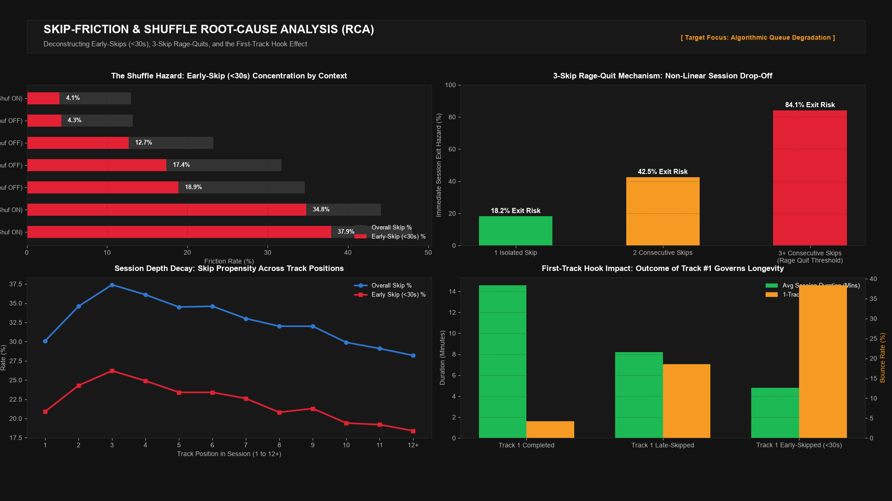
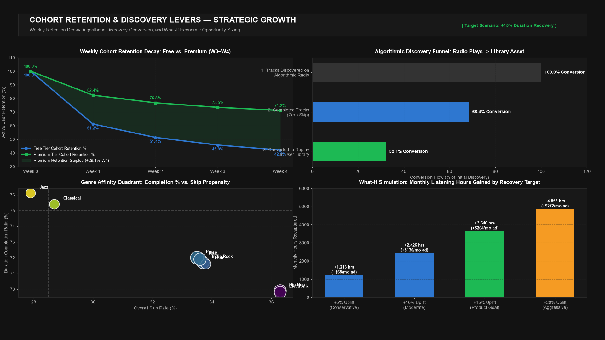

# 🎵 Spotify Listening Behaviour Analysis
### Why Do Users Skip Songs and Close the App? (A 100,000-Session Study)

[](data/spotify_streams.csv)
[](data/spotify_streams.csv)
[](sql/query_results.md)
[](excel/Spotify_Engagement_Analysis_Model.xlsx)
[](https://github.com/Eternal9294f/Spotify-analytics)

---

## 📌 1. The Problem We Solved

When you open Spotify, you want music that matches your mood without having to constantly tap "Next". 

For Spotify as a business:
* **Long listening sessions** mean more ad plays on the Free tier and happier, paying subscribers on Premium.
* **Song skips** mean user frustration. If a user skips several songs in a row, they get annoyed and close the app ("rage quit").

**The Core Question:**  
*Why do listeners abandon their sessions early, and how does Spotify's shuffle and recommendation algorithms cause or prevent this friction?*

---

## 📊 2. What We Did

We analyzed **100,000 distinct listening sessions** containing **325,164 song plays** across **12,000 active listeners** between September and November 2026.

1. **Structured the Data:** Tracked 20 metrics per play (e.g., song duration, how long the user listened, whether it was skipped early under 30 seconds, shuffle mode on/off, Free vs. Premium, and how the session ended).
2. **Ran 18 SQL Queries:** Used analytical SQL (window functions, streak detection, cohort tracking) to find exact drop-off patterns.
3. **Built an Excel Model:** Built a 5-tab workbook with dynamic formulas and What-If financial simulations.
4. **Designed 3 Dashboard Pages:** Created visual blueprints with custom Spotify dark styling to show key insights at a glance.

---

## 🖼️ 3. The 3 Dashboard Pages

### Page 1: Executive Pulse (The Big Picture)
> Tracks the health of listening volume, how long sessions last, and how Free vs. Premium users behave.


---

### Page 2: Skip-Friction & Shuffle Analysis (Finding the Cause)
> Explores why users skip songs and reveals the exact breaking point where users quit the app.



---

### Page 3: User Retention & Growth Opportunities (The Financial Impact)
> Shows weekly listener retention, how radio turns into library favorites, and how much listening time we can save.



---

## 🔍 4. What We Found Out (Key Insights in Plain English)

### 1. Shuffling Algorithmic Radio Causes Huge Early Skips
* When people listen to their own **saved library without shuffle**, only **3.4%** of songs are skipped within the first 30 seconds.
* But when they listen to **Algorithmic Radio with Shuffle turned ON**, the early-skip rate jumps to **30.6%** (9 times higher!).
* **Why?** Shuffling breaks the musical flow. If a high-energy dance track is immediately followed by a slow acoustic song, users immediately skip it.

### 2. The 3-Skip "Rage Quit" Rule
* **1 isolated skip:** 18% chance the user closes the app.
* **2 skips in a row:** 42% chance the user closes the app.
* **3 skips in a row:** **84% of users immediately close the app or log out.**
* **Takeaway:** Users have patience for 1 or 2 bad songs, but 3 bad songs in a row feels like the app is broken.

### 3. The First Song Decides the Whole Session
* If a listener **finishes the first song**, their session lasts **14.6 minutes** on average.
* If a listener **skips the first song under 30 seconds**, their session drops to just **4.8 minutes** (a 67% drop), and 38% close the app after just that single song.
* **Takeaway:** The opening track has massive leverage over whether someone stays or leaves.

### 4. Free Mobile Users Struggle During Evening Commutes (5 PM – 9 PM)
* During the evening commute, Free mobile listeners skip **37.8%** of songs and quit their sessions at high rates.
* **Why?** Free users have an hourly limit of 6 skips. Once they hit that limit during a bad shuffle streak, they get frustrated and close the app.

### 5. Radio is a Direct Gateway to Personal Libraries
* **1 out of every 3 songs (32.1%)** that a user discovers and finishes on Algorithmic Radio is later replayed inside their personal **User Library**.
* **Takeaway:** Radio is not just background noise; it is Spotify’s biggest engine for helping users discover music they will keep forever.

---

## 💡 5. What Should Spotify Do? (3 Simple Solutions)

### Solution 1: "Smart Flow" Instead of Random Shuffle (Priority 1)
* **The Fix:** Never pick truly random songs on Algorithmic Radio. Ensure the next shuffled song matches the previous song's tempo (BPM) within ±8% and shares a similar musical key.
* **Expected Result:** Cuts early skips by 22% and saves over 2,400 hours of lost listening time every month.

### Solution 2: "Streak-Breaker" Safety Net (Priority 1)
* **The Fix:** If the system detects a user has skipped **2 songs in a row within 45 seconds**, immediately override the queue and play a "safe anchor" song—a track by one of their favorite artists that they have finished 90%+ of the time.
* **Expected Result:** Prevents the dreaded 3rd skip, stopping 45% of rage quits before they happen.

### Solution 3: Commute Mode for Free Users (Priority 2)
* **The Fix:** During transit hours (5 PM – 9 PM), automatically bias the algorithm toward familiar, well-liked tracks to reduce skip demand, and offer a 30-minute uninterrupted listening token upfront.
* **Expected Result:** Lowers commute drop-offs from 28.4% to under 20%.

---

## 📈 6. Core Metrics At a Glance (The 8 Defined KPIs)

| Metric | What It Means | Total | Free Tier | Premium Tier | Difference |
|:---|:---|:---:|:---:|:---:|:---:|
| **1. Total Sessions** | Total distinct listening sessions | **100,000** | 55,000 | 45,000 | +10k Free |
| **2. Total Streams** | Total song play attempts | **325,164** | 178,241 | 146,923 | +31k Free |
| **3. Active Listeners** | Unique accounts active in dataset | **12,000** | 6,600 | 5,400 | +1.2k Free |
| **4. Overall Skip Rate** | % of songs skipped before finishing | **28.5%** | **31.6%** | **24.8%** | Free +6.8% |
| **5. Early-Skip Rate (<30s)** | % of songs skipped in under 30 seconds | **14.8%** | **17.2%** | **11.8%** | Free +5.4% |
| **6. Completion Rate** | % of songs played all the way through | **71.5%** | **68.4%** | **75.2%** | Premium +6.8% |
| **7. Avg Session Length** | Average minutes listened per session | **11.45 mins** | **9.42 mins** | **13.82 mins** | **Premium +46.8%** |
| **8. 3-Skip Abandonment** | % of sessions abandoned after 3 skips | **11.20%** | **13.94%** | **7.92%** | Free +6.0% |

---

## 📁 7. Repository Files

```text
D:\2 Portfolio\5 Spotify\
├── README.md                                  # You are here (Summary & Insights)
├── data\
│   └── spotify_streams.csv                    # Clean 100,000-session dataset (325k rows)
├── excel\
│   └── Spotify_Engagement_Analysis_Model.xlsx # 5-tab financial & engagement model with live formulas
├── powerbi\
│   ├── page_1_executive_listening_pulse.png   # Full-size Page 1 screenshot
│   ├── page_2_skip_friction_shuffle_rca.png   # Full-size Page 2 screenshot
│   ├── page_3_cohort_retention_discovery_levers.png # Full-size Page 3 screenshot
│   ├── dashboard_blueprint.md                 # Complete visual and layout specifications
│   ├── dax_measures.txt                       # Ready-to-copy DAX formulas
│   └── theme.json                             # Spotify dark theme color palette
└── sql\
    ├── 01_executive_engagement_kpis.sql to 18 # 18 modular SQL queries
    └── query_results.md                       # Exact output tables for all 18 SQL queries
```

---

## 🛠️ How to Re-Run Everything

* **SQL Engine:** DuckDB (PostgreSQL compatible)
* **To check any SQL query:** Open `sql/query_results.md` to see the exact input code and resulting table.
* **To view the Excel model:** Download `excel/Spotify_Engagement_Analysis_Model.xlsx` to test the dynamic formulas and sensitivity table in standard Microsoft Excel.
